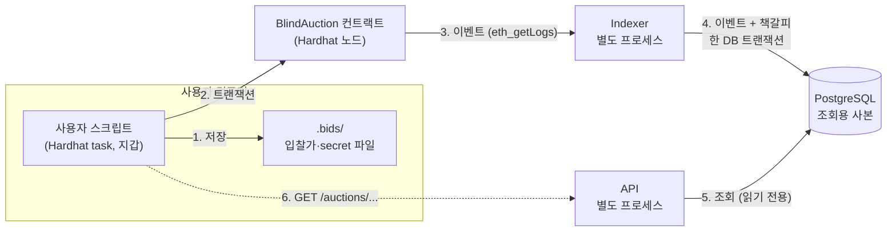

# Blind Auction

NFT를 ETH로 비공개 입찰하는 경매(Commit-Reveal). 입찰가는 해시로 숨겨 내고, 입찰 기간이 끝나면 각자 공개한다. NFT와 ETH의 교환은 스마트 컨트랙트가 보장하고, Indexer가 이벤트를 PostgreSQL에 모으며, REST API가 조회를 제공한다.

- **동작하는 것:** 경매 생성 → 입찰 → 공개 → 낙찰·정산 → 출금 전체, 이벤트 수집(중단 후 재시작 시 누락·중복 없음), 조회 API, 사용자 스크립트
- **테스트:** 컨트랙트 89개(커버리지 줄 100%), 통합 49개(실제 프로세스를 띄워 확인하는 시스템 테스트 포함)
- **설계 문서:** [docs/design.md](docs/design.md). 이 README는 요약과 이유만 담고, 자세한 내용은 "design.md N번"으로 연결한다.

## 목차

1. [빠른 시작](#1-빠른-시작)
2. [설계 방식과 이유](#2-설계-방식과-이유)
3. [구성 요소와 연동](#3-구성-요소와-연동)
4. [테스트](#4-테스트)
5. [장애 발생 시 복구](#5-장애-발생-시-복구)
6. [보안](#6-보안)
7. [개발 과정](#7-개발-과정)

## 1. 빠른 시작

**필요한 것:** Node.js 20.12 이상, Docker Desktop. Windows·macOS·Linux 모두 같은 명령으로 동작한다.

```bash
# 0. 설치 (처음 한 번)
cp .env.example .env              # Windows PowerShell: Copy-Item .env.example .env
npm install                       # 루트: db, indexer, api, 통합 테스트
cd contracts && npm install && cd ..

# 1. PostgreSQL과 테이블
docker compose up -d
npm run db:init

# 2. [터미널 1] 로컬 블록체인. 트랜잭션이 없어도 5초마다 블록을 만든다
cd contracts && npm run node

# 3. 컨트랙트 배포. 출력의 마지막 두 줄을 .env에 넣는다
cd contracts && npm run deploy
#   CONTRACT_ADDRESS=0xe7f1725E7734CE288F8367e1Bb143E90bb3F0512
#   DEPLOY_BLOCK=2

# 4. [터미널 2] Indexer, [터미널 3] API (루트에서)
npm run indexer
npm run api

# 5. design.md 7번 예시를 한 번에 실행하고 API로 확인
cd contracts && npm run demo
curl http://localhost:3000/auctions/0
```

`demo`는 실행할 때마다 새 NFT와 새 경매를 만들어 판매자(계정 0)와 입찰자 A~D(계정 1~4)로 예시를 끝까지 진행하고, 장부가 7번과 같은지 검사한다.

**스크립트 직접 실행** (`cd contracts && npm run <이름> -- <옵션>`, design.md 12번)

| 명령 | 예시 |
|---|---|
| `deploy` | `npm run deploy` |
| `mint-nft` | `npm run mint-nft` (계정 0에게 테스트 NFT 발행) |
| `create-auction` | `npm run create-auction -- --token 1 --bidding 10m --reveal 1d` |
| `bid` | `npm run bid -- --auction 0 --value 3 --deposit 5 --account 1` |
| `reveal` | `npm run reveal -- --auction 0 --account 1` |
| `finalize` | `npm run finalize -- --auction 0` |
| `withdraw` | `npm run withdraw -- --account 1` |
| `time-travel` | `npm run time-travel -- --auction 0 --to reveal` (`--to end`, `--seconds 1d`) |
| `demo` | `npm run demo` |

금액은 ETH, 기간은 `10m`/`1d` 형식이다. 지갑은 로컬 노드의 기본 계정 번호(`--account`)로 고른다. 입찰하면 입찰가와 secret이 `.bids/`에 저장된다. 이 파일이 있어야 공개할 수 있다.

**API** (모두 GET, design.md 11번)

| 주소 | 내용 |
|---|---|
| `/auctions` | 전체 경매 목록 |
| `/auctions?status=active` | 진행 중 (입찰 중·공개 중·종료 대기) |
| `/auctions?status=finalized` | 종료된 경매 |
| `/auctions/:auctionId` | 상세, 진행 상태, 결과, 입찰 목록 |
| `/users/:address/auctions` | 그 주소가 참여한 경매와 그 사람의 입찰 |

금액은 wei 문자열, 주소는 소문자, 시간은 unix 초다. 모든 응답의 `asOf`는 진행 상태를 계산한 기준 블록이다.

**환경 변수** (`.env`, 비밀값이 있어 Git에 올리지 않는다)

| 이름 | 쓰는 곳 | 설명 |
|---|---|---|
| `POSTGRES_*`, `DATABASE_URL` | Docker, 전체 | DB 접속 정보 |
| `RPC_URL`, `CHAIN_ID` | Indexer | 노드 주소, chain id(Hardhat 31337) |
| `CONTRACT_ADDRESS`, `DEPLOY_BLOCK` | Indexer | `deploy`가 출력하는 값 |
| `BATCH_SIZE`, `POLL_INTERVAL_MS`, `RETRY_DELAY_MS` | Indexer | 한 번에 읽을 블록 수, 새 블록 확인 주기, 오류 후 재시도 대기 |
| `API_PORT` | API | 기본 3000 |

## 2. 설계 방식과 이유

### 경매 규칙 (design.md 4번)

| 규칙 | 이유 |
|---|---|
| 경매 대상은 ERC-721 NFT. 생성 때 컨트랙트가 보관한다 | 블록체인 밖 물건은 전달을 보장할 수 없다. NFT는 컨트랙트가 직접 넘길 수 있다 |
| 기간은 판매자가 정한다: 입찰 10분~5일, 공개 1~2일 | 공개는 입찰자 모두가 직접 해야 하므로 여유 있게 둔다 |
| 해시 = 입찰가 + secret + 입찰자 주소 | 남의 해시를 복사해 입찰해도 주소가 달라 공개할 수 없다 |
| 보증금 ≥ 입찰가여야 유효. 무효면 보증금 전액 반환 | 입찰가를 숨기면서 낙찰자가 낼 돈을 미리 확보한다. 무효는 규칙 위반이 아니라 조건 미달이라 돌려준다 |
| 공개하지 않으면 보증금 몰수(판매자에게) | 남의 공개를 보고 불리하면 빠지는 행동을 막는다 |
| 최고가 낙찰. 동점이면 **먼저 입찰한** 사람 | 결과가 하나로 정해져야 한다. 공개 순서는 조작할 수 있어 입찰 순서로 정한다 |
| 지갑당 한 경매에 1회 입찰. 판매자 입찰은 막지 않는다 | 구조가 단순해진다. 판매자는 다른 지갑으로 우회할 수 있어 막아도 의미가 없다 |
| 종료는 공개 마감 후 누구나 1회 | 판매자만 할 수 있으면 결과가 싫은 판매자가 호출하지 않아 보증금이 묶인다 |

최저가, 경매 취소, 여러 번 입찰, 가짜 입찰은 일부러 넣지 않았다 (design.md 16번).

### 핵심 결정

**반환은 종료 때가 아니라 공개 때 장부에 적는다 (design.md 7번).** 종료 때 한꺼번에 돌려주려면 입찰자 전체를 반복문으로 돌아야 하고, 입찰자가 많으면 트랜잭션 가스 상한에 걸려 종료가 실행되지 않는다. 공개는 한 명씩 들어오므로 그때 결과를 적으면 반복문이 없다.

| 공개 결과 | 공개 때 장부에 적는 것 |
|---|---|
| 무효, 또는 유효하지만 현재 최고가에 짐 | 본인 보증금 전액 |
| 새 최고가 | 밀려난 이전 최고가의 보증금 전액 (본인 차액은 종료 때) |

종료 때는 두 줄만 적는다: 낙찰자에게 보증금 − 낙찰가, 판매자에게 낙찰가 + 몰수금. 몰수금은 `보증금 합계 − 공개된 보증금 합계`라서 역시 반복문이 없다.

**예시** (design.md 7번. 공개 순서 A → B → C, D는 공개하지 않음)

| 입찰자 | 보증금 | 입찰가 | 결과 | 장부 |
|---|---|---|---|---|
| A | 5 | 3 | B에게 밀림 | 5 |
| B | 4 | 4 | 낙찰 | 0 |
| C | 2 | 3 | 무효 | 2 |
| D | 3 | 미공개 | 몰수 | - |
| 판매자 | | | | 4 + 3 = 7 |

장부 합계 14 = 보증금 합계 14. 컨트랙트에 남거나 모자라는 돈이 없다. `npm run demo`와 테스트가 이 숫자를 그대로 검사한다.

**돈은 직접 보내지 않고 장부에 적어 각자 출금한다 (Pull).** 컨트랙트가 여러 명에게 송금하면, 받기를 거부하는 한 명 때문에 모두의 정산이 막힌다.

**쓰기는 지갑에서 컨트랙트로, 읽기는 DB로 (design.md 3번).** API가 대신 트랜잭션을 보내면 서버가 돈과 개인키를 쥐어야 하고 `msg.sender`가 서버가 된다. 블록체인에는 검색 기능이 없고 과거 기록은 이벤트로만 남으므로, Indexer가 이벤트를 DB에 모으고 API는 DB만 조회한다. 둘이 다르면 블록체인이 맞고, DB는 다시 읽어 맞춘다.

**진행 상태는 저장하지 않고 블록 시간으로 계산한다 (design.md 10번).** 저장하면 시간이 지나도 값이 안 바뀐다. 서버 시계가 아니라 Indexer가 마지막으로 읽은 블록의 시간을 써서 컨트랙트와 같은 기준으로 판단한다. 트랜잭션이 없으면 블록 시간이 멈추므로 개발용 노드는 5초마다 빈 블록을 만든다.

**secret은 입찰자 컴퓨터에만 둔다 (design.md 8번).** 서버나 DB에 두면 관리자, 해킹, API 버그 중 하나만으로 공개 전에 입찰가가 드러난다. 입찰 스크립트는 secret 파일을 **트랜잭션을 보내기 전에** 저장한다. 보낸 뒤에 저장하면, 성공 직후 프로그램이 죽었을 때 secret을 잃어 공개할 수 없고 보증금이 몰수된다.

## 3. 구성 요소와 연동



| 구성 요소 | 하는 일 | 위치 |
|---|---|---|
| 스마트 컨트랙트 | 경매 규칙 실행, NFT·ETH 보관, 결과를 이벤트로 남김 (원본) | `contracts/contracts/BlindAuction.sol` |
| 사용자 스크립트 | 생성·입찰·공개·종료·출금 트랜잭션을 지갑에서 직접 보냄 | `contracts/tasks/`, `contracts/scripts/lib/` |
| Indexer | 이벤트를 블록 범위로 읽어 DB에 저장. 책갈피로 이어 읽음 | `indexer/` |
| PostgreSQL | 검색하기 쉽게 모은 사본. 테이블 정의는 한 곳 | `db/schema.sql` |
| API | DB를 조회해 돌려줌. 쓰기 없음 | `api/` |

**Indexer와 API를 따로 실행하는 이유:** Indexer가 멈추거나 재시작해도 API는 계속 조회에 답한다. `asOf`를 보면 데이터가 어느 블록 기준인지 알 수 있다.

**이벤트 → DB (design.md 6번, 10번):** Indexer는 이벤트 하나만 보고 DB를 채운다.

| 이벤트 | DB |
|---|---|
| `AuctionCreated` | auctions 행 생성 |
| `BidCommitted` | bids 행 생성 (결과 `unrevealed`) |
| `BidRevealed` | 입찰가, 결과 `valid` / `invalid` |
| `AuctionFinalized` | 낙찰자·낙찰가·몰수금, 유효 입찰은 `won` / `lost` |
| `Withdrawn` | 저장하지 않음 (조회에 쓰는 곳이 없음) |

금액은 `NUMERIC(78,0)`(wei, uint256 최댓값까지 정확), 주소는 소문자, 시간은 unix 초로 저장한다. 사용자 테이블은 없다. 보증금·입찰가·결과는 "그 사람이 그 경매에 한 입찰"에 붙는 정보라서다.

**폴더**

```
contracts/   컨트랙트, 컨트랙트 테스트, 사용자 스크립트(tasks/, scripts/lib/)
indexer/     이벤트 수집 → DB, 복구 명령(reset.ts)
api/         조회 API (Express)
db/          테이블 생성 SQL, db:init
tests/       통합 테스트 (Vitest + Supertest)
docs/        설계 문서
```
